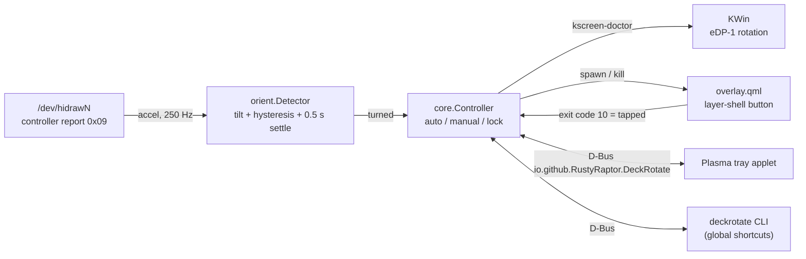

# deckrotate

Screen rotation for the Steam Deck in KDE Plasma (Wayland) desktop mode:
auto-rotate from the Deck's motion sensor, a tap-to-rotate button, a rotation
lock, a system tray applet and global shortcuts.

SteamOS can't auto-rotate on its own: the Deck has no accelerometer the
kernel knows about. deckrotate reads the one built into the controller
instead (see [docs/hardware.md](docs/hardware.md)).

## Features

- **Auto mode**: the screen follows the Deck as soon as it settles in a new
  position (0.5 s by default, adjustable from 0.1 to 3 s).
- **Manual mode**: turning the Deck shows a round button in the bottom-right
  corner, as you're now holding it, for 5 seconds (adjustable from 2 to 30 s).
  Tap it to rotate.
- **Lock**: stops both modes reacting to the sensor. Explicit rotations from the
  applet, CLI or shortcuts still work.
- **Tray applet**: pick any of the four orientations, rotate left/right, lock,
  switch modes and adjust both timings. Middle-click the tray icon to toggle
  the lock.
- **Global shortcuts** for lock, rotate left/right/flip, each orientation,
  mode toggle, and "accept" for the manual-mode button.
- Lying the Deck flat, or shaking it, never triggers a rotation.

## Install

Needs Go via [mise](https://mise.jdx.dev/) (`mise.toml` pins it). Everything
installs under `$HOME`, so SteamOS's read-only root is untouched.

```sh
mise run install
systemctl --user enable --now deckrotate
```

That installs:

| What              | Where                                                       |
|-------------------|-------------------------------------------------------------|
| daemon + CLI      | `~/.local/bin/deckrotate`                                   |
| overlay QML       | `~/.local/share/deckrotate/ui/`                             |
| tray applet       | `~/.local/share/plasma/plasmoids/io.github.rustyraptor.deckrotate/` |
| shortcut actions  | `~/.local/share/kglobalaccel/io.github.rustyraptor.deckrotate.desktop` |
| systemd user unit | `~/.config/systemd/user/deckrotate.service`                 |

The applet adds itself to the system tray. If it doesn't, right-click the tray,
open **Configure System Tray → Entries** and set **Screen Rotation** to shown.

The shortcut actions appear under **System Settings → Keyboard → Shortcuts →
Screen Rotation** after you next log in (KWin reads that directory at session
start). None have a default key, so pick your own. With Steam Input you can
bind a key combination to a Deck button combo.

`mise run uninstall` removes everything.

## CLI

```
deckrotate status [--json]
deckrotate lock | unlock | toggle-lock
deckrotate mode auto|manual|toggle
deckrotate rotate cw|ccw|flip
deckrotate rotate landscape|portrait-cw|landscape-flipped|portrait-ccw
deckrotate settle 700ms          # 100ms to 3s
deckrotate prompt-timeout 8s     # 2s to 30s
deckrotate accept     # take the manual-mode button's rotation
deckrotate dismiss
```

`portrait-cw` is the Deck turned clockwise (right grip down); `portrait-ccw`
is left grip down. Settings persist in `~/.config/deckrotate/settings.json`.

## How it works



| Package             | Role                                                          |
|---------------------|---------------------------------------------------------------|
| `internal/imu`      | find the controller, decode reports, keep the IMU switched on |
| `internal/orient`   | accelerometer vector → orientation, debounced                 |
| `internal/display`  | read/set the panel rotation with `kscreen-doctor`             |
| `internal/core`     | the mode/lock state machine                                   |
| `internal/overlay`  | button placement maths and the overlay process                |
| `internal/service`  | D-Bus object, properties and client                           |
| `internal/daemon`   | wiring; reopens the IMU after suspend/resume                  |
| `ui/`               | the manual-mode overlay (QML + LayerShellQt)                  |
| `plasmoid/`         | the tray applet (QML)                                         |

The applet and overlay are QML because Plasma applets must be, and a Wayland
corner overlay needs layer-shell, which has no pure-Go binding. Everything
else is Go with CGO off.

### D-Bus API

Service and interface `io.github.RustyRaptor.DeckRotate`, object
`/io/github/RustyRaptor/DeckRotate`.

| Property               | Type | Notes                                   |
|------------------------|------|-----------------------------------------|
| `Mode`                 | s    | `auto` or `manual`                      |
| `Locked`               | b    |                                         |
| `DeviceOrientation`    | s    | physical position, `unknown` until read |
| `ScreenOrientation`    | s    | what the panel is rotated for           |
| `SuggestedOrientation` | s    | manual-mode offer, empty when none      |
| `ImuAvailable`         | b    |                                         |
| `SettleMs`             | i    | settle time in milliseconds             |
| `PromptTimeoutMs`      | i    | manual-mode button lifetime in ms       |

Methods: `SetMode(s)`, `ToggleMode()`, `SetLocked(b)`, `ToggleLock()`,
`RotateTo(s)`, `RotateBy(i quarterTurnsClockwise)`, `SetSettleMs(i)`,
`SetPromptTimeoutMs(i)`, `Accept()`, `Dismiss()`.
Properties emit `PropertiesChanged`.

## Development

Written test-first. `mise run test` runs:

| Task            | What                                                                |
|-----------------|---------------------------------------------------------------------|
| `test:go`       | Go unit tests (private `dbus-daemon` for the service tests)          |
| `test:qml`      | overlay QML tests, offscreen                                        |
| `test:plasmoid` | applet view and logic tests against a mock backend                  |
| `test:dbus`     | applet's real D-Bus backend against the Go service on a private bus |

`mise run test:hw` reads the real controller. The race detector needs cgo;
on the Deck: `nix shell nixpkgs#gcc --command env CGO_ENABLED=1 go test -race ./...`.

Logs: `journalctl --user -u deckrotate -f`.

## License

MIT
